# mermaid-layout-circular

A circular layout for mermaid flowcharts.

> [!tip]
> Try it in the
[playground](https://andrewbroz.github.io/mermaid-layout-circular/).
> Pick an example, edit its text, and switch the settings on and off.

[mermaid](https://mermaid.js.org) turns text into diagrams. It lays
out flowcharts in rows, so a cycle comes out as a line with one long
arrow looping back. This package adds a circular layout. A layout
decides where each box goes, and the path each arrow takes. Here the
nodes sit at even spacing on a circle. Each arrow follows the circle to the
next node.

In Obsidian, use the
[obsidian-mermaid-circular](https://github.com/AndrewBroz/obsidian-mermaid-circular)
plugin instead. Obsidian is a notes app that can draw mermaid
diagrams.

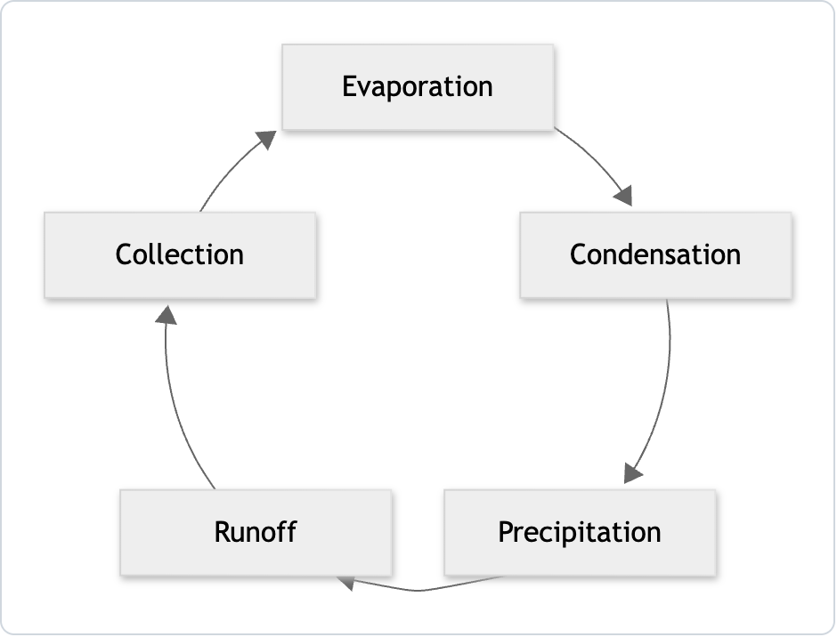

Pick the layout in the diagram's frontmatter. That is the settings
block between two `---` lines at the top of the diagram. This is the
text for the picture above:

```
---
config:
  layout: circular
---
flowchart LR
  E[Evaporation] --> C[Condensation]
  C --> P[Precipitation]
  P --> R[Runoff]
  R --> O[Collection]
  O --> E
```

mermaid's default layout, called dagre, draws the same text like this:

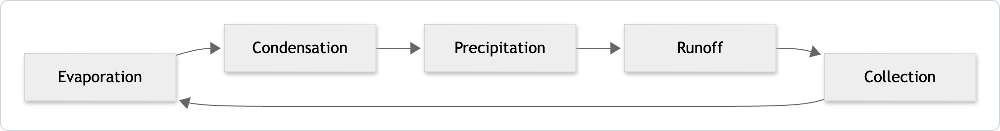

This answers a request open in mermaid since 2022,
[mermaid-js/mermaid#3228](https://github.com/mermaid-js/mermaid/issues/3228).

## Which package to use

The same circular layout comes in four packages. Pick the one that
matches how you draw diagrams.

Pele is a smaller program that draws diagrams from the same text.

| You draw diagrams with | Use |
| --- | --- |
| mermaid, in a web page or app | this package |
| Pele, in a web page or app | [pele-layout-circular](https://github.com/AndrewBroz/pele-layout-circular) |
| Obsidian, in your notes | [obsidian-mermaid-circular](https://github.com/AndrewBroz/obsidian-mermaid-circular), a plugin |
| your own code | [layout-circular](https://github.com/AndrewBroz/layout-circular), the shared placement math |

The first three use layout-circular to decide where each node goes.
They place nodes the same way. They differ in how boxes and text are drawn.

## Install

```sh
npm install mermaid mermaid-layout-circular
```

Register the layout once, before mermaid draws anything:

```ts
import mermaid from 'mermaid';
import circularLayouts from 'mermaid-layout-circular';

mermaid.registerLayoutLoaders(circularLayouts);
```

Works with mermaid 11.12 and later, including every 12.x release.

### From a CDN

A web page can load both packages from jsDelivr, with no build step:

```html
<pre class="mermaid">
---
config:
  layout: circular
---
flowchart LR
  A --> B --> C --> D --> A
</pre>

<script type="module">
  import mermaid from 'https://cdn.jsdelivr.net/npm/mermaid@12/dist/mermaid.esm.min.mjs';
  import circularLayouts from
    'https://cdn.jsdelivr.net/npm/mermaid-layout-circular@0.10/dist/mermaid-layout-circular.js';

  mermaid.registerLayoutLoaders(circularLayouts);
  await mermaid.run();
</script>
```

## Write a circular diagram

`layout: circular` places the first node at the top and runs
clockwise. `layout: circular-ccw` runs counter-clockwise.

The rest of the flowchart language works as usual: node shapes, edge
labels, styles, classes and themes. The direction after `flowchart`
(LR, TB) has no effect on this layout.

mermaid's hand-drawn look works too:

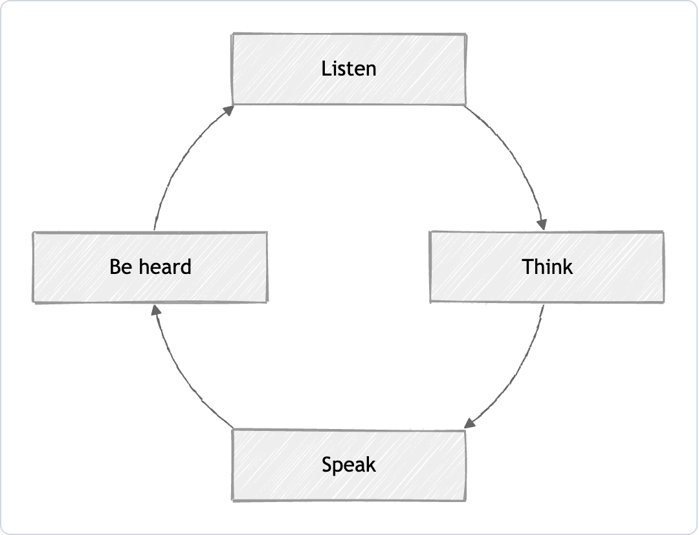

```
---
config:
  layout: circular
  look: handDrawn
  theme: neutral
---
flowchart LR
  L[Listen] --> T[Think]
  T --> S[Speak]
  S --> H[Be heard]
  H --> L
```

## Straight edges

By default, an arrow between two neighbors on the circle is curved
along it. Set `flowchart.curve` to `linear` to draw straight lines
instead, so the ring becomes a polygon.

An arrow between two nodes that are not neighbors is called a chord.
A chord is always a straight line across the circle. When two straight
arrows join the same two nodes, they are drawn as parallel lines, each
with its label on its own side.

| Curved arrows (the default) | `curve: linear` |
| --- | --- |
| 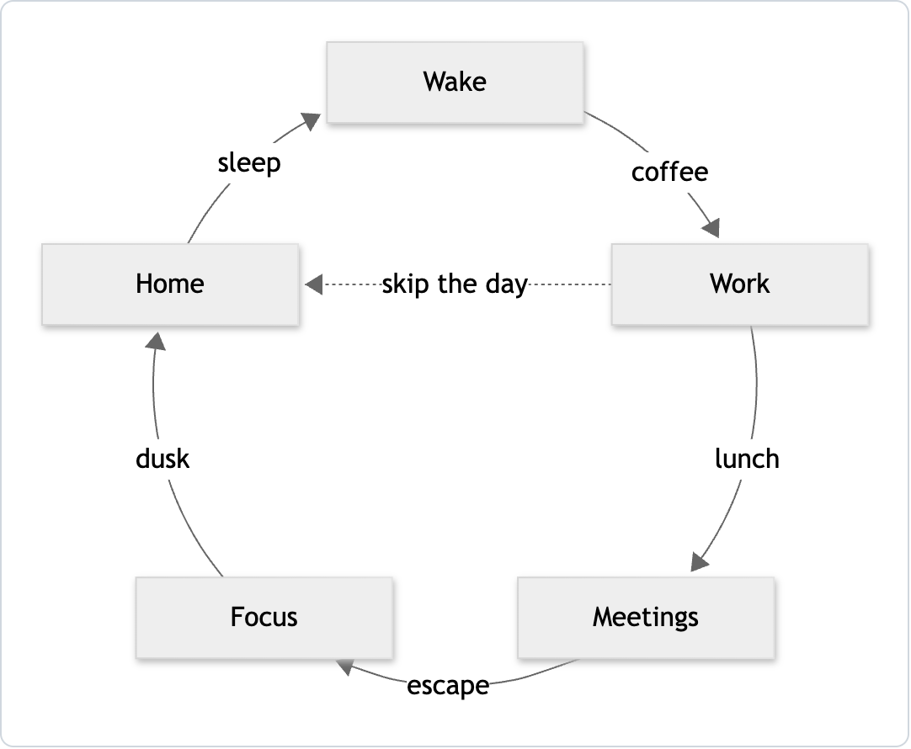 | 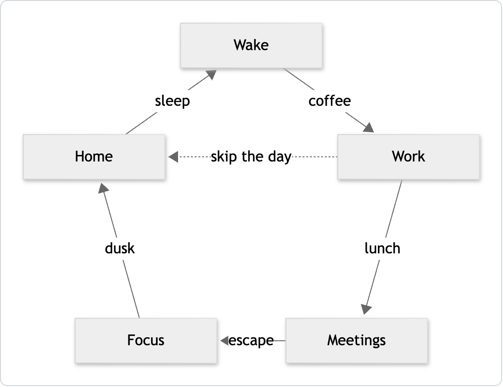 |

The text for the straight version is below. The curved one is the
same without the `flowchart` and `curve` lines.

```
---
config:
  layout: circular
  flowchart:
    curve: linear
---
flowchart LR
  W[Wake] -->|coffee| Wk[Work]
  Wk -->|lunch| M[Meetings]
  M -->|escape| F[Focus]
  F -->|dusk| Hm[Home]
  Hm -->|sleep| W
  Wk -.->|skip the day| Hm
```

## Groups

A subgraph (a group of nodes) keeps its members next to each other on
the circle. A group is drawn as a tight box when one fits, however
much of the circle it covers. The circle turns, if needed, so the box
clears every other node. Where the top of a box has no room for its
title, the title may go below the box instead.

A group becomes a band, a strip that follows the circle, only when no
box fits. On the right, any box around Core would cover Registry. When
arrows cross the top of a box, its title moves to the bottom.

| A group a box can clear: a box | A group no box can clear: a band |
| --- | --- |
| 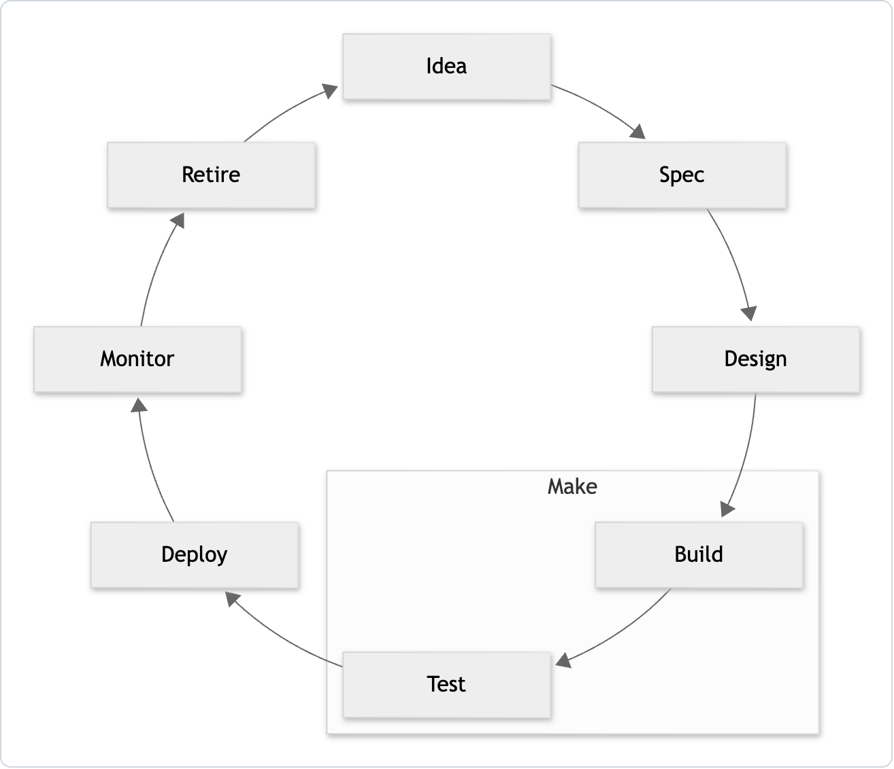 | 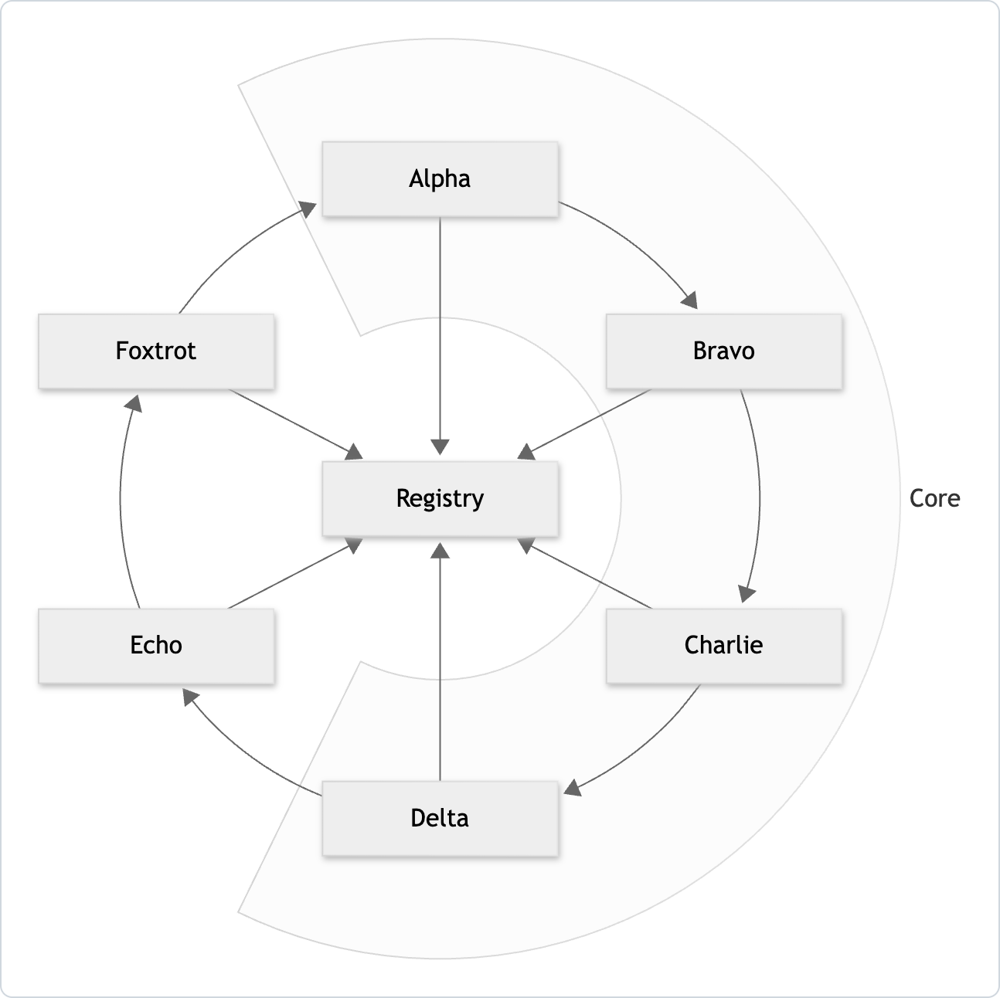 |

More group examples are in the [gallery](docs/GALLERY.md#groups).

## More shapes

Not every diagram is one plain cycle. The layout keeps the main cycle
on the circle, called the ring, and places everything else around it.
A hub is one node linked to most of the others. A satellite is a
second, smaller cycle hanging off the ring, drawn as its own circle. A
branch is a node that hangs off the ring, pointing outward; the
[gallery](docs/GALLERY.md#branches) shows branches.

<table>
<tr>
<td align="center">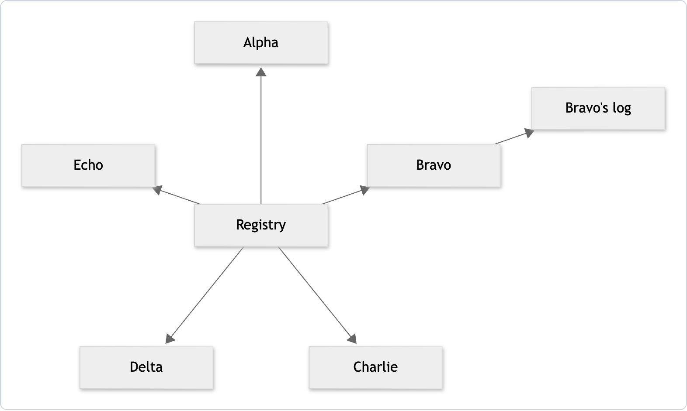<br>A hub goes in the middle</td>
<td align="center">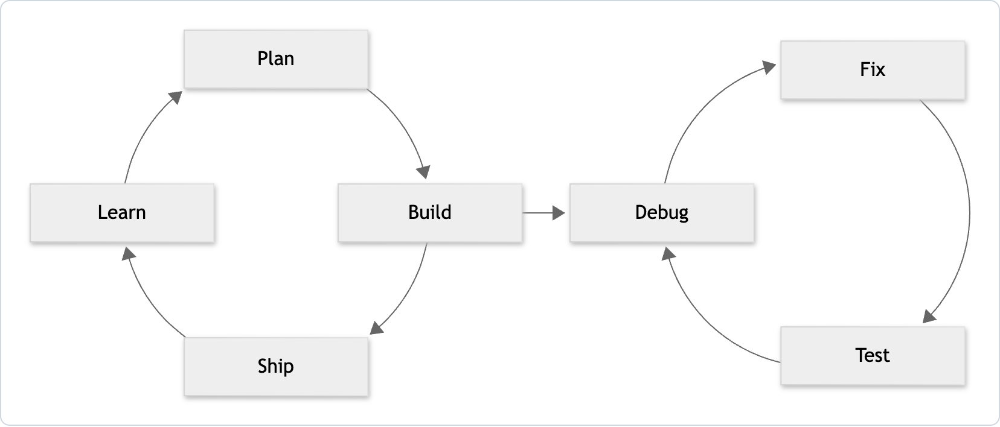<br>A cycle off the ring gets its own circle</td>
</tr>
<tr>
<td align="center">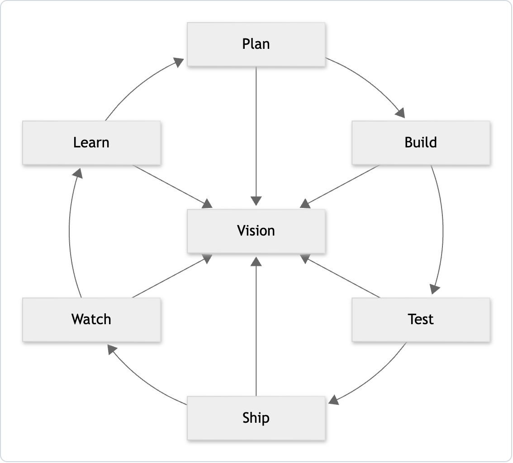<br>A wheel: a ring around a hub</td>
<td align="center">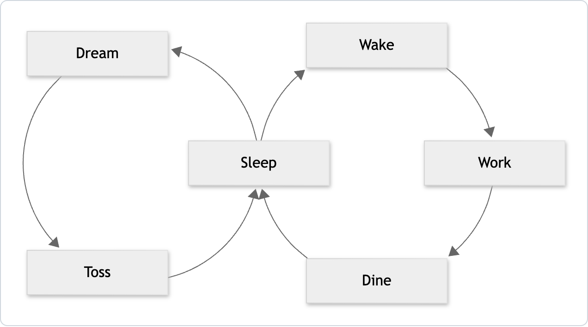<br>Two cycles sharing a node: a figure-eight</td>
</tr>
</table>

The source of every picture on this page is in
[docs/GALLERY.md](docs/GALLERY.md), along with more examples. The
[live gallery](https://andrewbroz.github.io/mermaid-layout-circular/gallery.html)
draws every case in your browser.

## Hubs

The layout puts a node in the middle only when the diagram's shape
calls for it. Two shapes do.

- A wheel. One node in the cycle links to more of the cycle's nodes
  than any other node does, and to at least three. The cycle still
  closes without it. A node linked to every other node in the cycle
  also counts, even if the cycle has gaps.
- A star. The diagram has no cycle, and one node has more links than
  any other, at least three.

You can turn this off, or name the hub yourself. This is set in code,
next to the registration, not in frontmatter:

```ts
import { setCircularLayoutOptions } from 'mermaid-layout-circular';

setCircularLayoutOptions({ hub: 'none' }); // never use a hub
// or
setCircularLayoutOptions({ hub: 'Hub' }); // the node with id Hub is the hub
```

A node's id is the name before its brackets in the diagram text. In
the hub picture above, `Hub[Registry]` has the id `Hub`.

## Options

mermaid's settings have no place for layout options, so you set them in
code with `setCircularLayoutOptions`, next to the registration:

```ts
setCircularLayoutOptions({ spacing: 60, hub: 'none' });
```

Each call replaces the options set before it, so pass them all in one
call.

- `spacing`, the gap between nodes, starts from mermaid's own
  `flowchart.nodeSpacing`.
- A diagram's own frontmatter wins over options set in code. A diagram
  that says `circular-ccw` or `curve: linear` gets that, whatever the
  code set.

[All options](https://github.com/AndrewBroz/layout-circular/blob/main/docs/OPTIONS.md)
are listed in layout-circular, with their defaults.

## Limits

- An arrow that points at a subgraph itself, not a node in it, is
  dropped, with a warning in the console.
- With `look: handDrawn`, a band is drawn with plain lines.
- If the page scales the diagram with a CSS transform, edge labels can
  overlap. mermaid measures labels in screen pixels.
- Only flowcharts are supported.
- The package uses mermaid's `InternalHelpers`, which mermaid marks as
  not for outside use. mermaid's own elk and tidy-tree layouts use them
  too.

## Development

`npm test`, `npm run lint` and `npm run build` are the checks.
`npm run dev` serves the playground and the gallery locally. `npm run docs:images` redraws
the pictures in this README and the gallery. The reasons behind the
design are in [docs/DECISIONS.md](docs/DECISIONS.md).

## License

MIT
