# Gallery

These pictures are drawn by [mermaid](https://mermaid.js.org), a tool that turns text into diagrams, with this package's circular layout. Each one shows the diagram text that made it. Set `layout: circular` in the frontmatter, the settings block between the two `---` lines, to get this layout.

The ring is the circle the nodes sit on. The same diagrams drawn by Pele, another renderer for mermaid text, are in [pele-layout-circular's gallery](https://github.com/AndrewBroz/pele-layout-circular/blob/main/docs/GALLERY.md).

The pictures are redrawn by `npm run docs:images`. The [live gallery](https://andrewbroz.github.io/mermaid-layout-circular/) draws them in your browser.

## Shapes

### Branches

A branch is a node that hangs off the ring, pointing outward. Idea feeds in from above. Build log and Release notes point away from the ring.

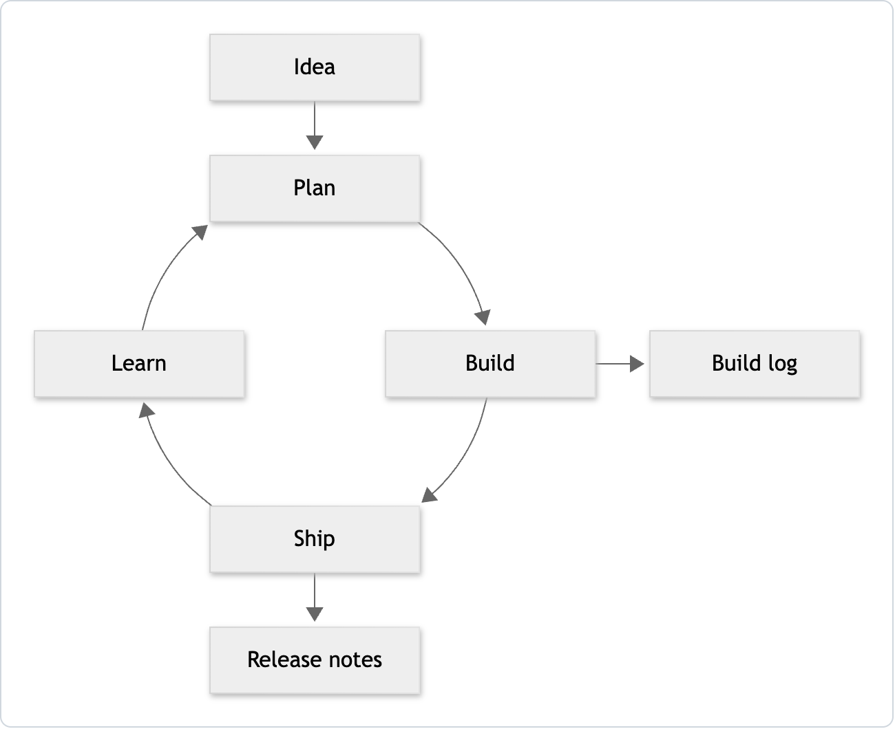

```
---
config:
  layout: circular
---
flowchart LR
  P[Plan] --> B[Build] --> S[Ship] --> L[Learn] --> P
  I[Idea] --> P
  S --> N[Release notes]
  B --> G[Build log]
```

### A hub

A hub is one node linked to most of the others. The layout puts it in the middle. Bravo's log hangs off Bravo as a branch.

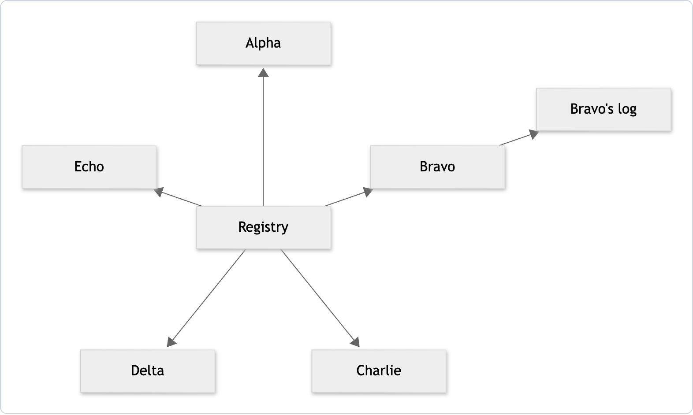

```
---
config:
  layout: circular
---
flowchart LR
  Hub[Registry] --> A[Alpha]
  Hub --> B[Bravo]
  Hub --> C[Charlie]
  Hub --> D[Delta]
  Hub --> E[Echo]
  B --> L[Bravo's log]
```

### A wheel

A wheel is a ring with a hub. Every ring node links to Vision, so Vision goes in the middle and each link is a straight spoke.

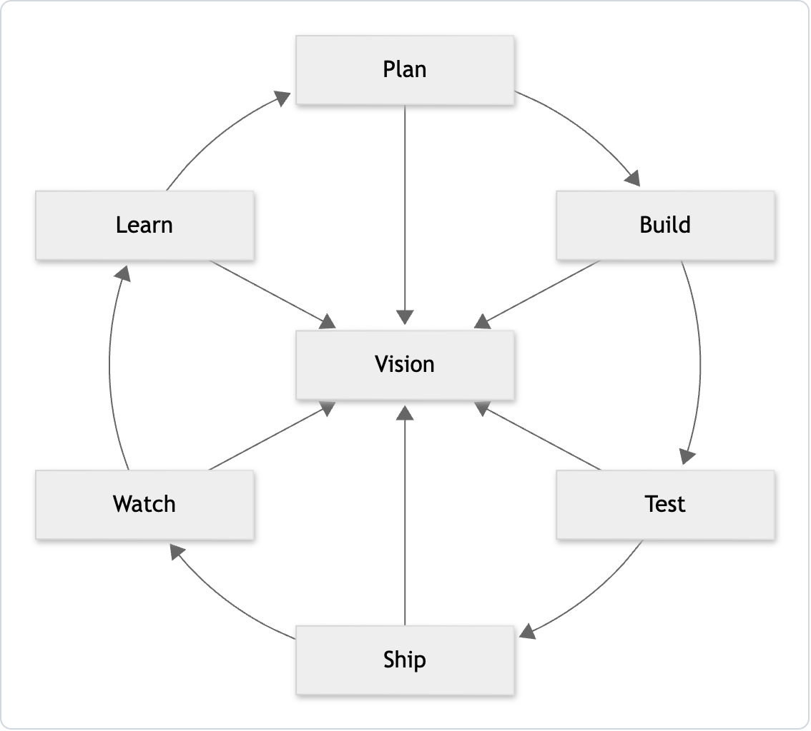

```
---
config:
  layout: circular
---
flowchart LR
  A[Plan] --> B[Build] --> C[Test] --> D[Ship] --> E[Watch] --> F[Learn] --> A
  A --> Hub[Vision]
  B --> Hub
  C --> Hub
  D --> Hub
  E --> Hub
  F --> Hub
```

### A satellite

A satellite is a second, smaller cycle hanging off the ring. It gets its own circle, beyond the node it hangs from.

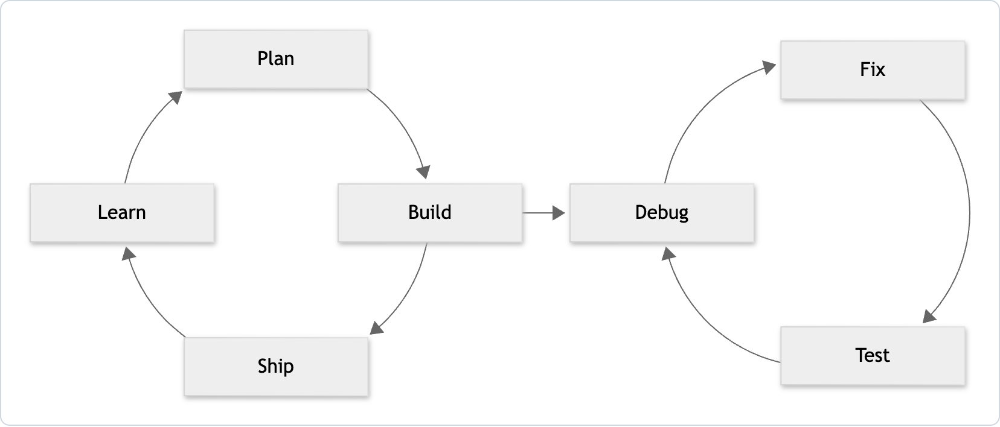

```
---
config:
  layout: circular
---
flowchart LR
  P[Plan] --> B[Build] --> S[Ship] --> L[Learn] --> P
  B --> D[Debug]
  D --> F[Fix] --> T[Test] --> D
```

### A figure-eight

Two cycles that share one node make a figure-eight. The smaller circle runs the other way round from the main ring, as a textbook would draw it.

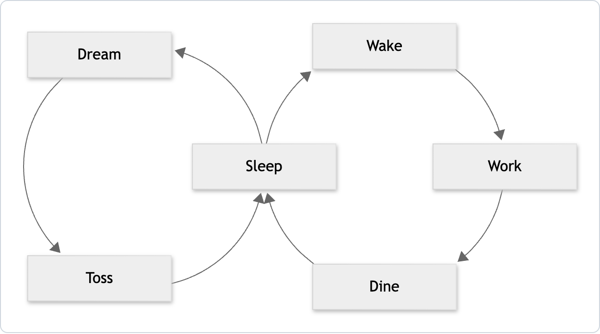

```
---
config:
  layout: circular
---
flowchart LR
  W[Wake] --> K[Work] --> N[Dine] --> S[Sleep] --> W
  S --> R[Dream] --> T[Toss] --> S
```

### Three gears

Cycles can link in a chain. Each circle runs the other way round from the one it touches, like gears.

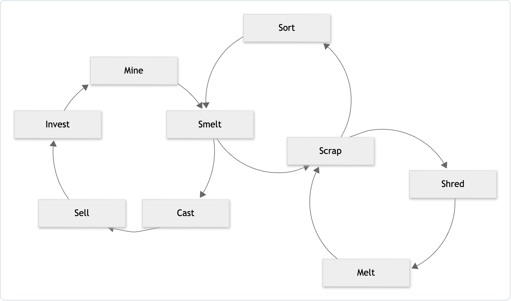

```
---
config:
  layout: circular
---
flowchart LR
  A[Mine] --> B[Smelt] --> C[Cast] --> D[Sell] --> E[Invest] --> A
  B --> F[Scrap]
  F --> G[Sort] --> B
  F --> H[Shred]
  H --> I[Melt] --> F
```

### A large cycle with inputs and outputs

Eight nodes on the ring, with one input and three outputs as branches.

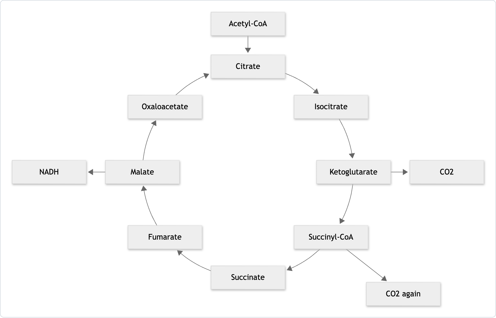

```
---
config:
  layout: circular
---
flowchart LR
  A[Citrate] --> B[Isocitrate] --> C[Ketoglutarate] --> D[Succinyl-CoA]
  D --> E[Succinate] --> F[Fumarate] --> G[Malate] --> H[Oxaloacetate] --> A
  AcCoA[Acetyl-CoA] --> A
  C --> CO2a[CO2]
  D --> CO2b[CO2 again]
  G --> NADH
```

### A wheel with gaps

The ring here is missing an arc between Water and Wind. Captain Planet links to every ring node, so it still goes in the middle. Vapor and Ice form a satellite off Water. The `<-->` arrows point both ways.

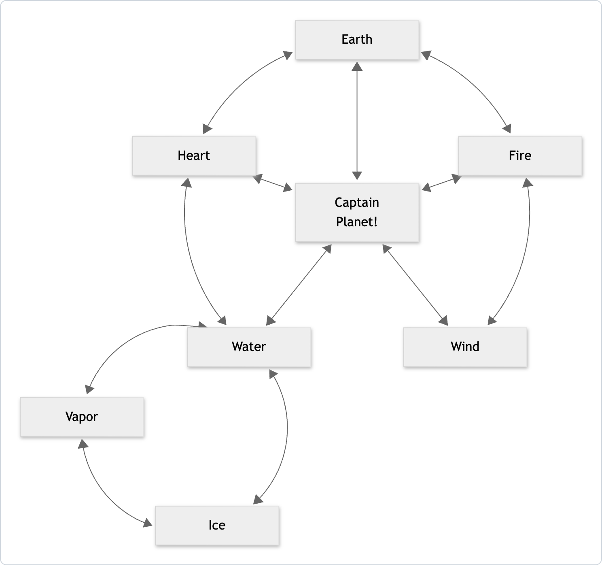

```
---
config:
  layout: circular
---
flowchart TB
  P[Captain
  Planet!]
  Earth <--> P
  Fire <--> P
  Wind <--> P
  Water <--> P
  Heart <--> P
  Heart <--> Water
  Heart <--> Earth
  Earth <--> Fire
  Fire <--> Wind
  Water <--> Vapor
  Vapor <--> Ice
  Ice <--> Water
```

### A branch and a satellite on one node

Build has both a branch and a satellite. They share the space beyond Build, side by side.

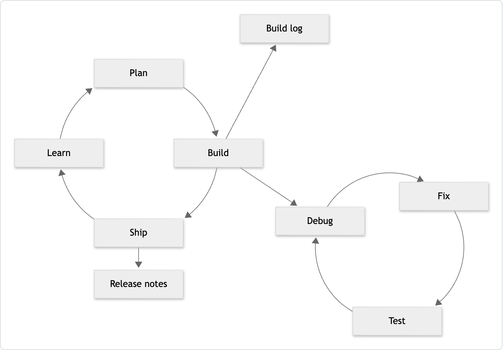

```
---
config:
  layout: circular
---
flowchart LR
  P[Plan] --> B[Build] --> S[Ship] --> L[Learn] --> P
  B --> D[Debug]
  D --> F[Fix] --> T[Test] --> D
  B --> Log[Build log]
  S --> Notes[Release notes]
```

## Groups

### A small group

A subgraph (a group of nodes) keeps its members next to each other on the circle. A small group is drawn as a tight box. The circle turns, if needed, so the box clears every other node.

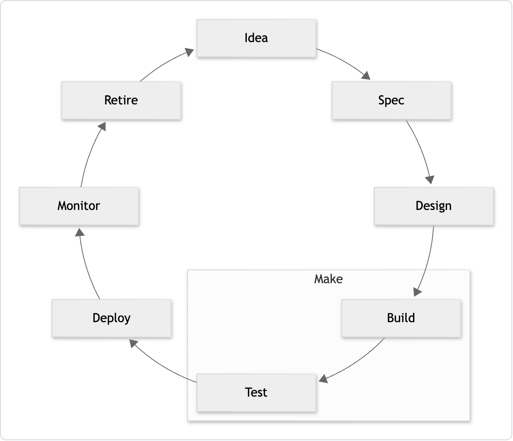

```
---
config:
  layout: circular
---
flowchart LR
  I[Idea] --> S[Spec] --> D[Design]
  subgraph Make
    B[Build]
    T[Test]
  end
  D --> B --> T --> P[Deploy] --> M[Monitor] --> R[Retire] --> I
```

### A group around most of the ring

A group that covers half the circle or more is drawn as a band, a strip that follows the circle. Its title sits outside it.

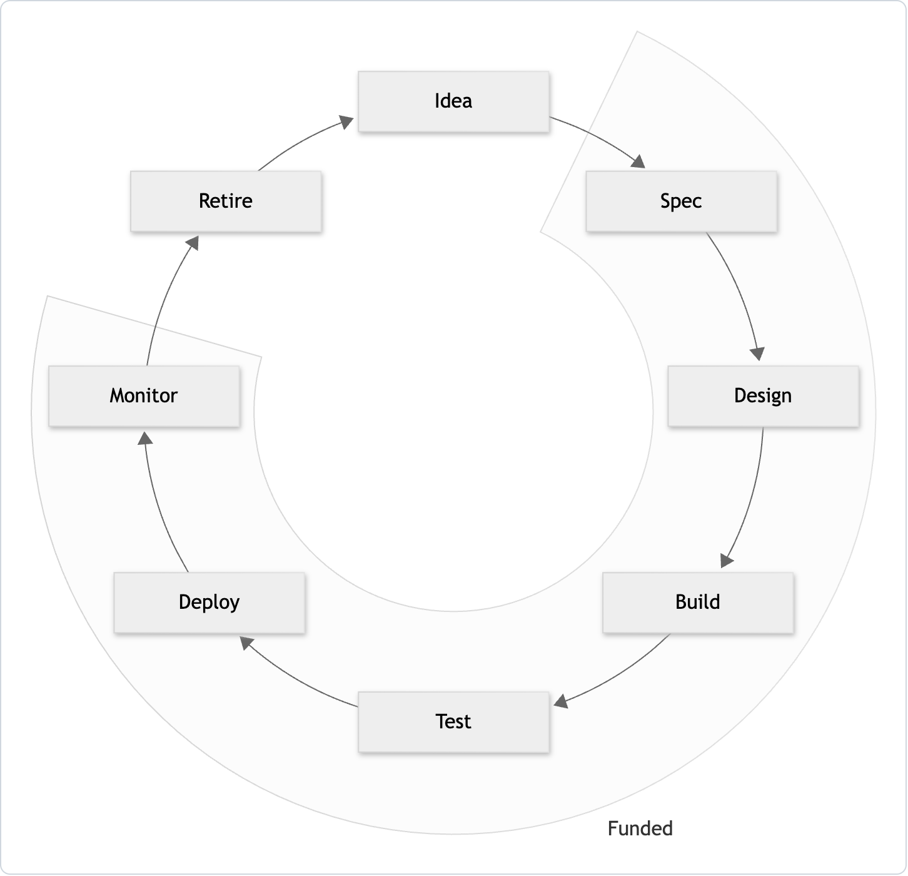

```
---
config:
  layout: circular
---
flowchart LR
  I[Idea]
  subgraph Funded
    S[Spec]
    D[Design]
    B[Build]
    T[Test]
    P[Deploy]
    M[Monitor]
  end
  I --> S --> D --> B --> T --> P --> M --> R[Retire] --> I
```

### A group inside a band

A group inside a band is drawn as a band too. Its title sits between the two. The `style` line colours the inner group.

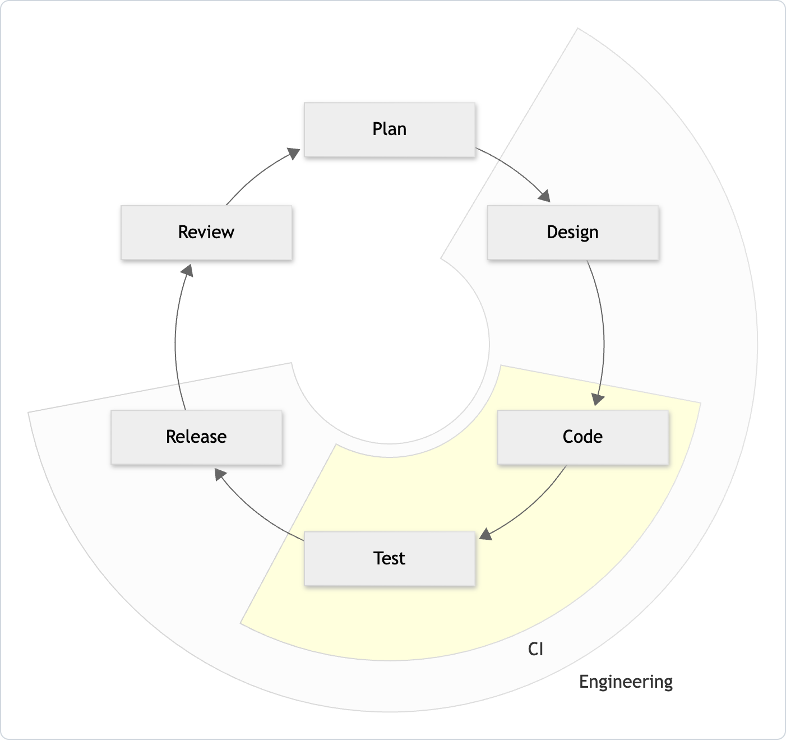

```
---
config:
  layout: circular
---
flowchart LR
  P[Plan]
  subgraph Engineering
    D[Design]
    subgraph CI
      C[Code]
      T[Test]
    end
    R[Release]
  end
  P --> D --> C --> T --> R --> V[Review] --> P
  style CI fill:#ffd
```

### A title moved to the bottom

Spokes from Registry cross the top of the Archive box. So the title moves to the bottom, where no arrow crosses.

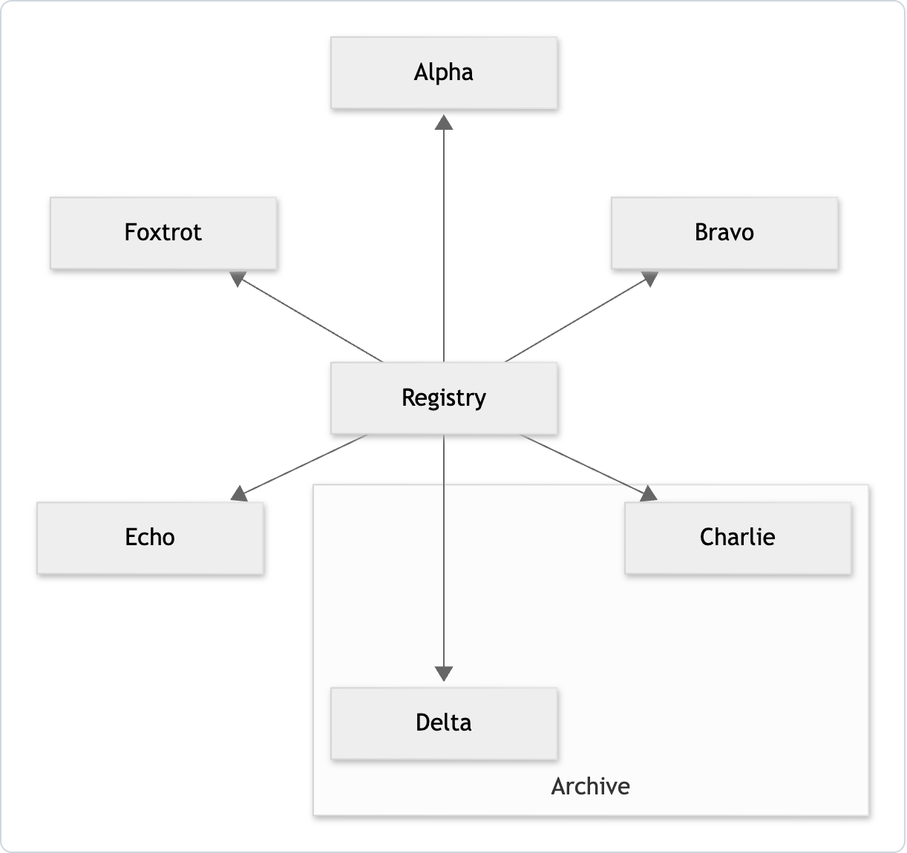

```
---
config:
  layout: circular
---
flowchart LR
  Hub[Registry] --> A[Alpha]
  Hub --> B[Bravo]
  Hub --> C[Charlie]
  Hub --> D[Delta]
  Hub --> E[Echo]
  Hub --> F[Foxtrot]
  subgraph Archive
    C
    D
  end
```

### A group around a satellite

A group can hold a whole satellite. The box wraps the smaller circle.

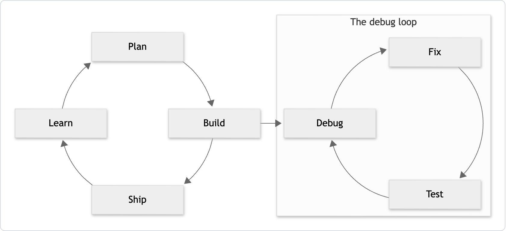

```
---
config:
  layout: circular
---
flowchart LR
  P[Plan] --> B[Build] --> S[Ship] --> L[Learn] --> P
  B --> D[Debug]
  subgraph The debug loop
    D --> F[Fix] --> T[Test] --> D
  end
```

## Arrows

### Labels and a chord

Each label sits in the gap between two nodes. An arrow between two nodes that are not neighbours is a chord, a straight line across the circle.

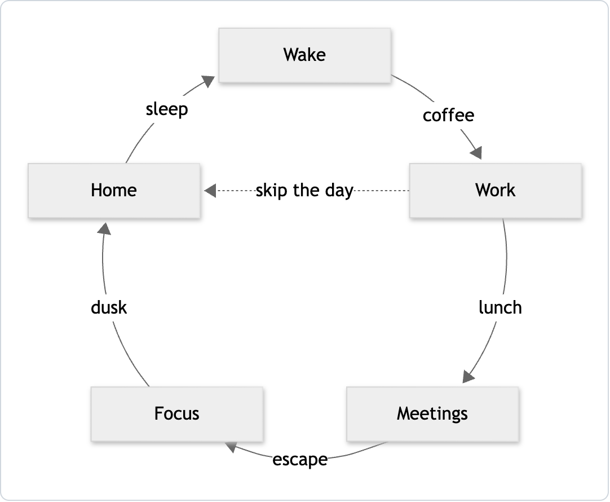

```
---
config:
  layout: circular
---
flowchart LR
  W[Wake] -->|coffee| Wk[Work]
  Wk -->|lunch| M[Meetings]
  M -->|escape| F[Focus]
  F -->|dusk| Hm[Home]
  Hm -->|sleep| W
  Wk -.->|skip the day| Hm
```

### Straight edges

`flowchart.curve: linear` draws the arrows between neighbours as straight lines. The ring becomes a polygon.

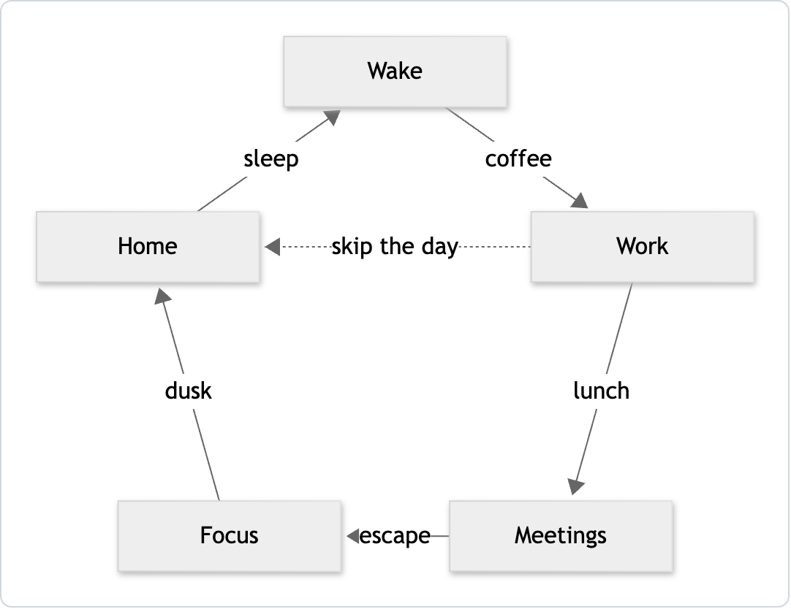

```
---
config:
  layout: circular
  flowchart:
    curve: linear
---
flowchart LR
  W[Wake] -->|coffee| Wk[Work]
  Wk -->|lunch| M[Meetings]
  M -->|escape| F[Focus]
  F -->|dusk| Hm[Home]
  Hm -->|sleep| W
  Wk -.->|skip the day| Hm
```

### Two arrows between the same nodes

When two straight arrows join the same two nodes, they are drawn as parallel lines. Each label steps aside to its own line's side.

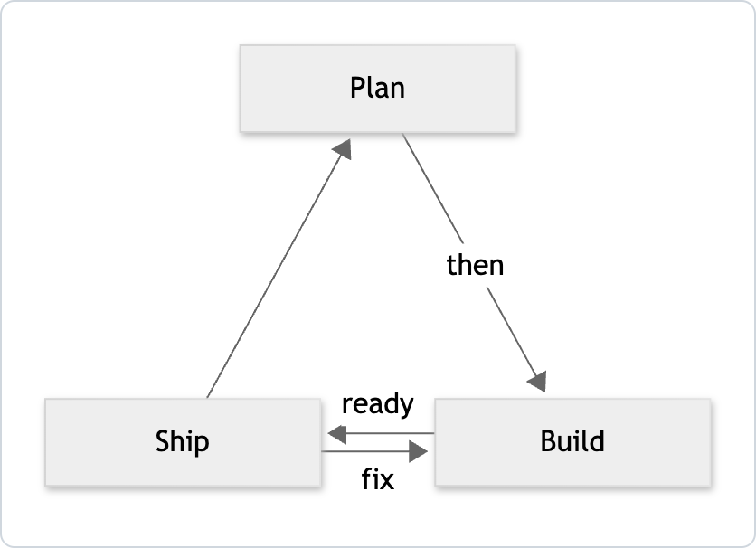

```
---
config:
  layout: circular
  flowchart:
    curve: linear
---
flowchart LR
  A[Plan] -->|then| B[Build]
  C[Ship] --> A
  B -->|ready| C
  C -->|fix| B
```

### A self-loop and an arrow back

An arrow from a node to itself loops outside the ring. Review points back to Draft along a second curve.

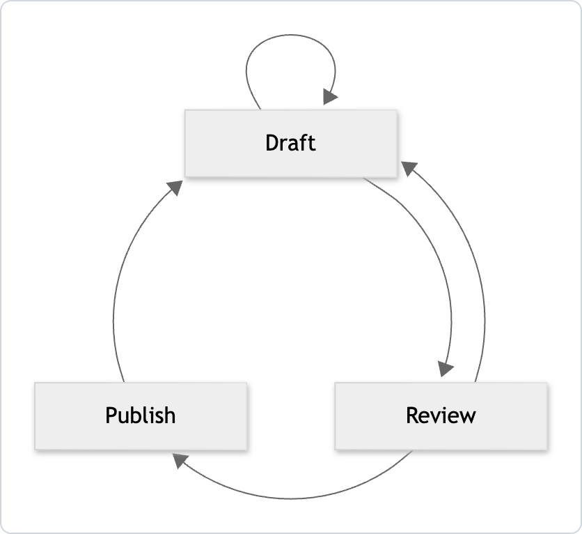

```
---
config:
  layout: circular
---
flowchart LR
  A[Draft] --> B[Review]
  B --> A
  B --> C[Publish]
  C --> A
  A --> A
```

## Other

### Counter-clockwise

`layout: circular-ccw` runs the ring counter-clockwise from the top.

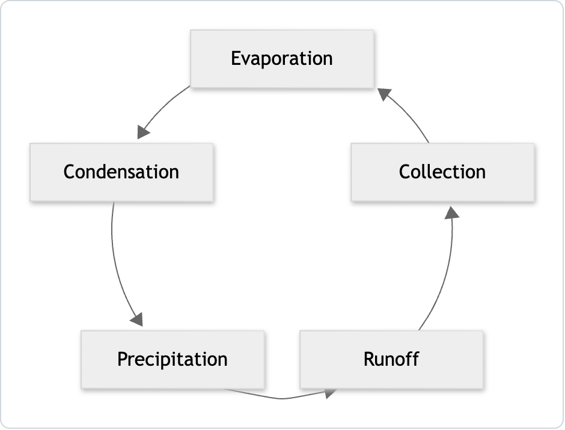

```
---
config:
  layout: circular-ccw
---
flowchart LR
  E[Evaporation] --> C[Condensation]
  C --> P[Precipitation]
  P --> R[Runoff]
  R --> O[Collection]
  O --> E
```

### Mixed shapes and sizes

Node shapes work as usual. The circle grows to fit the widest node.

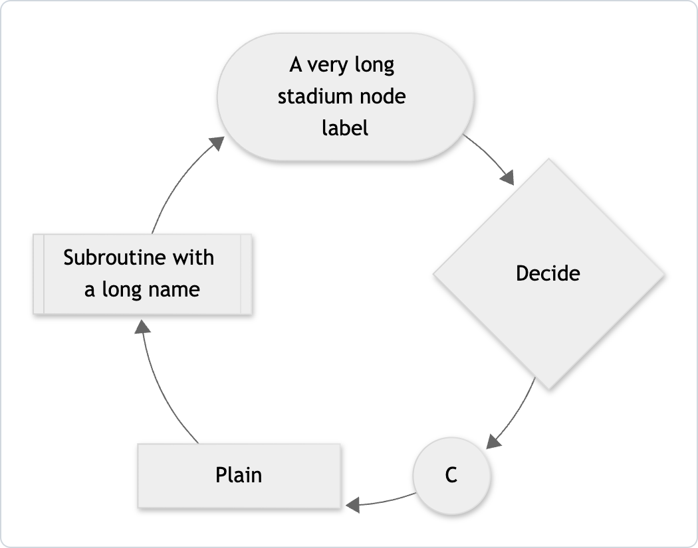

```
---
config:
  layout: circular
---
flowchart LR
  A([A very long stadium node label]) --> B{Decide}
  B --> C((C))
  C --> D[Plain]
  D --> E[[Subroutine with a long name]]
  E --> A
```
